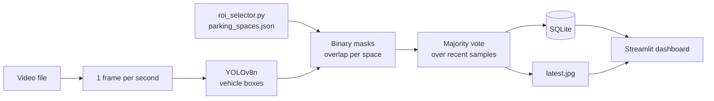

<div align="center">

# SmartParkSense

**Parking-space occupancy monitoring from video, using YOLOv8 and computer vision.**


[](https://github.com/daniaalhayk/SmartParkSense/actions/workflows/ci.yml)

</div>

SmartParkSense watches a fixed camera view of a parking lot. You draw the parking spaces once, then the system detects vehicles in a video, decides for every space whether it is **occupied** or **free**, stores the results in SQLite and shows them in a Streamlit dashboard.

##  Demo

### Detection Output


Red = occupied, green = free, blue boxes = YOLO detections.

### Dashboard


## Features

-  **Vehicle detection** with YOLOv8n (cars, motorcycles, buses, trucks).
-  **Manual space definition**: click four corners on a video frame, the tool turns them into a parallelogram that follows the camera angle.
-  **Occupancy decision per space** from the overlap between each space and the detected vehicles, smoothed over several samples to avoid flickering.
-  **Local storage** of every reading in SQLite.
-  **Dashboard** with KPI cards, the latest annotated frame, a per-space status grid and optional auto-refresh.

##  How it works



1. Every parking space is stored as a polygon with coordinates between 0 and 1, so it does not depend on the video resolution.
2. One frame per second of video is processed.
3. YOLOv8n returns a box for each vehicle.
4. Each space polygon becomes a binary mask (OpenCV `fillPoly`, NumPy arrays). The overlap is the shared pixels divided by the **area of the space**.
5. A space counts as occupied when this overlap reaches `OVERLAP_THRESHOLD` in most of the last `SMOOTH_WINDOW` samples.
6. Results go to SQLite and an annotated `latest.jpg`; the dashboard only reads them, so processing and display run as separate programs.

##  Tech stack

| | Technology | Used for |
|---|---|---|
|  | Python | Application logic |
|  | Ultralytics YOLOv8n | Vehicle detection |
|  | OpenCV | Video reading, masks, drawing |
|  | NumPy | Image and mask arrays |
|  | SQLite | Storing results |
|  | Pandas | Reading results as tables |
|  | Streamlit | Dashboard |
|  | Plotly | Charts |

The YOLOv8n model is pre-trained on the COCO dataset. It is **not** retrained in this project.

##  Getting started

Developed on Windows with Python 3.14. Other versions were not verified.

```powershell
git clone https://github.com/daniaalhayk/SmartParkSense.git
cd SmartParkSense
python -m venv .venv
.\.venv\Scripts\Activate.ps1
pip install -r requirements.txt
```

### Data

The video and the saved parking spaces are not part of the repository (`data/` is git-ignored).

- Put your video at `data/video.mp4`, or pass another path with `--video`.
- `data/parking_spaces.json` is created by step 1 below.
- The YOLOv8n weights (`yolov8n.pt`) are not stored in the repository; Ultralytics downloads them when they are missing.

### 1. Define the parking spaces (once per camera view)

```powershell
python roi_selector.py --video data/video.mp4
```

| Control | Action |
|---|---|
| Left click | Add a corner. The 4th click closes the space and adjusts that corner to form a parallelogram |
| Right click or `u` | Undo the last point (or the last space) |
| `Enter` | Close the current polygon |
| `s` | Save and exit |
| `Esc` | Exit without saving |

### 2. Process the video

```powershell
python process_video.py --video data/video.mp4
```

Press `q` in the preview window to stop. Each run clears the previous results for this video source before writing new ones.

### 3. Open the dashboard

```powershell
streamlit run app.py
```

Tabs: live view (latest annotated frame), weekly analytics (**simulated demo data**) and space status grid.

## 🔧 Configuration

All settings are in `config.py`.

| Symptom | Setting to review |
|---|---|
| Vehicles are missed | Lower `CONFIDENCE`, raise `IMG_SIZE`, or use a larger model in `MODEL_NAME` (for example `yolov8s.pt`) |
| Free spaces shown as occupied | Raise `OVERLAP_THRESHOLD` |
| Occupied spaces shown as free | Lower `OVERLAP_THRESHOLD` |
| Status flickers between frames | Raise `SMOOTH_WINDOW` |
| Vehicle area looks too large or too small | Change `BOX_BOTTOM_FRACTION` (share of each box, counted from the bottom, used as vehicle area) |
| Processing is too slow or too sparse | Change `SAMPLE_EVERY_SEC` or `IMG_SIZE` |

Test every change on representative footage: these values trade detection quality against speed and have not been tuned against labelled data.

##  Project structure

```text
SmartParkSense/
├── __pycache__/       # Python-generated cache files
├── data/              # Input video and generated data
├── .gitignore         # Git exclusion rules
├── app.py             # Streamlit dashboard
├── config.py          # Project configuration
├── database.py        # SQLite database operations
├── detector.py        # Vehicle detection and occupancy analysis
├── process_video.py   # Video processing pipeline
├── README.md          # Project documentation
├── requirements.txt   # Python dependencies
├── roi_selector.py    # Parking-space selection tool
├── spaces.py          # Parking-space coordinate utilities
└── yolov8n.pt          # YOLOv8n model weights
```


The tests cover the space files, the occupancy logic and the database. They do not load YOLO and do not need a video.


## 📄 License

[MIT License](./LICENSE).
